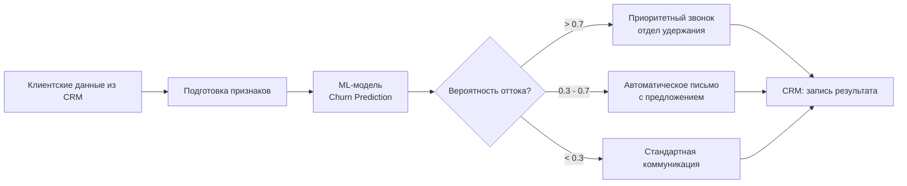

# Место ML-модели в бизнес-процессе удержания клиентов

## Краткое описание

**Место в процессе:** модель встроена в процесс удержания клиентов между этапом сбора данных из CRM и этапом коммуникации (звонок / письмо / стандартное обслуживание). Она не заменяет решение менеджера, а приоритизирует клиентов по риску.

**Какую задачу решает модель:**
Модель прогнозирует вероятность оттока клиента в ближайшие 30 дней. Она **приоритизирует** клиентов для команды удержания.

**Почему целесообразно использовать ML:**
Правила на основе экспертных порогов (например, «если tenure < 3 месяцев») не улавливают нелинейные комбинации десятков факторов. ML позволяет автоматически находить сложные паттерны в исторических данных и ранжировать клиентов по риску с большей точностью, чем ручная разметка.

**Какие данные поступают на вход модели:**
- Демографические (возраст, регион - только агрегированно)
- Поведенческие (частота входов в приложение, количество обращений в поддержку)
- Транзакционные (средний чек, количество покупок за 3 месяца)
- Тарифные (текущий план, срок действия)

**Как результат используется дальше:**
Предсказанная вероятность (0-1) передаётся в CRM. Клиенты с вероятностью > 0.7 попадают в список приоритетных для звонка отдела удержания. Клиенты с вероятностью 0.3-0.7 получают автоматическое письмо с предложением. Решение о конкретном действии остаётся за бизнес-правилами и менеджером.

## Схема процесса

