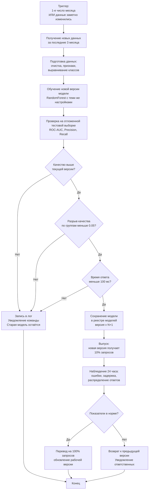

# Процесс автоматического переобучения модели прогнозирования оттока

## Общее описание

Процесс запускается автоматически - по расписанию или когда замечаем, что данные заметно изменились. Новая версия модели проходит обязательные проверки качества и безопасности, прежде чем попасть в работу.

## Схема процесса

## Детализация этапов

| Этап | Что происходит | Результат для следующего шага |
|------|---------------|-------------------------------|
| **1. Триггер** | Запуск по расписанию (1-е число месяца) или по сигналу мониторинга: распределение ключевых признаков заметно изменилось (PSI > 0.2). | Задача поставлена в очередь оркестратора (Airflow / Prefect). |
| **2. Получение данных** | Из хранилища выгружаются записи за последние 3 месяца, включая обновлённую метку оттока. | Сырой датасет в Parquet. |
| **3. Подготовка данных** | Очистка, заполнение пропусков, кодирование, выравнивание классов. Данные версионируются. | Обработанные train/validation/test. |
| **4. Обучение** | Запускается скрипт обучения с теми же настройками, что у текущей рабочей модели. | Файл модели (.pkl) + метрики. |
| **5. Проверка качества** | Считаются ROC-AUC, Precision, Recall на отложенной тестовой выборке. Сравнение с текущей рабочей версией. | Метрики и решение: прошла ли модель порог улучшения. |
| **6. Проверка справедливости** | Разрыв ROC-AUC между демографическими группами не должен превышать 0.05. | Отчёт о справедливости. |
| **7. Проверка скорости** | Время ответа модели в 95% случаев должно быть меньше 100 мс. | Решение о готовности к выпуску. |
| **8. Сохранение** | Модель сохраняется в реестре моделей с версией `v{N+1}`, метаданными и метриками; файл `.pkl` - в хранилище (S3). | Запись в реестре. |
| **9. Выпуск (пробный)** | Новая версия получает 10% запросов. Наблюдение за ошибками и задержками 24 часа. | Показатели пробного периода. |
| **10. Перевод / Возврат** | При успехе - 100% запросов. При неудаче - возврат к предыдущей версии, уведомление ответственных. | Рабочая версия обновлена (или сохранена). |

## Условия попадания в работу

Новая версия становится рабочей **только если**:

1. ROC-AUC на тесте ≥ ROC-AUC текущей версии.
2. Разрыв качества между группами ≤ 0.05.
3. Время ответа в 95% случаев ≤ 100 мс.
4. За 24 часа пробного периода ошибки не выросли больше чем на 5%, а задержки - больше чем на 20%.
